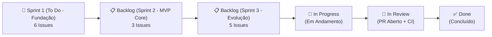

# 📊 Quadro Kanban Oficial & Divisão de Sprints — Escala Elderly (Front + Back)

> 🔗 **Acesso ao Quadro Interativo no GitHub Projects:**  
> 👉 **[https://github.com/users/augustoheiss/projects/1](https://github.com/users/augustoheiss/projects/1)**
>
> 💡 **Como clonar/vincular este quadro na aba `Projects` de `thomasalmeida09` em 1 clique:**  
> Como no GitHub contas pessoais só permitem que o próprio dono da conta (`thomasalmeida09`) vincule um Project na aba `Projects` do repositório, o `thomasalmeida09` pode abrir o link acima, clicar no botão **`...` (canto superior direito) $\rightarrow$ `Make a copy`**, marcar a caixinha **`Copy draft issues and issues`** e vincular ao repositório `thomasalmeida09/escala-elderly-backend`!

---

## 🗺️ Visão Geral das Colunas no GitHub Projects

---

## 🟢 Coluna 1: `🎯 Sprint 1 (To Do - Fundação)` — Prioridade Imediata

Objetivo: Deixar o Frontend e o Backend 100% compilando, padronizados com Prettier/Spotless, protegidos por Continuous Integration (GitHub Actions) e integrados via API REST + Persistência Local-First.

| Issue | Repositório | Título da Tarefa | Labels | Responsável |
| :--- | :---: | :--- | :--- | :--- |
| **[`BE #1`](https://github.com/thomasalmeida09/escala-elderly-backend/issues/1)** | `Backend` | `fix(api): corrigir erro de compilação em CuidadorController.java, adicionar .gitignore e formatação Spotless` | `bug`, `priority: critical`, `sprint-1: fundacao` | *A definir* |
| **[`FE #1`](https://github.com/thomasalmeida09/escala-elderly/issues/1)** | `Frontend` | `fix(ui): limpar CSS residual do Vite, carregar fontes, configurar Prettier e remover Tailwind inativo` | `bug`, `ui / ux`, `sprint-1: fundacao` | *A definir* |
| **[`BE #5`](https://github.com/thomasalmeida09/escala-elderly-backend/issues/5)** | `Backend` | `ci(governance): configurar GitHub Actions (Gradle Build/Test), Template de PR e documentação de ADRs do Backend` | `architecture`, `documentation`, `sprint-1: fundacao` | *A definir* |
| **[`FE #9`](https://github.com/thomasalmeida09/escala-elderly/issues/9)** | `Frontend` | `ci(governance): configurar GitHub Actions (Lint/Build), Template de PR e documentação de ADRs do Frontend` | `architecture`, `documentation`, `sprint-1: fundacao` | *A definir* |
| **[`BE #2`](https://github.com/thomasalmeida09/escala-elderly-backend/issues/2)** | `Backend` | `feat(api): alinhar contrato de dados com o Frontend e criar endpoints de atualização de status (PATCH/POST)` | `enhancement`, `priority: high`, `sprint-1: fundacao` | *A definir* |
| **[`FE #2`](https://github.com/thomasalmeida09/escala-elderly/issues/2)** | `Frontend` | `feat(data): arquitetura Local-First (persistência offline) integrada à API Spring Boot com fallback automático` | `enhancement`, `local-first`, `sprint-1: fundacao` | *A definir* |

---

## 🔵 Coluna 2: `📋 Backlog (Sprint 2 - MVP Core)` — Resolução da Dor do Onboarding

Objetivo: Entregar as funcionalidades principais de negócio em módulos desacoplados (zero conflito de merge entre a equipe).

| Issue | Repositório | Título da Tarefa | Labels | Responsável |
| :--- | :---: | :--- | :--- | :--- |
| **[`FE #7`](https://github.com/thomasalmeida09/escala-elderly/issues/7)** | `Frontend` | `feat(coverage): sugestão inteligente 'Quem Pode Cobrir?' e acionamento rápido via WhatsApp ao registrar falta` | `enhancement`, `priority: high`, `sprint-2: mvp-core` | *A definir* |
| **[`FE #3`](https://github.com/thomasalmeida09/escala-elderly/issues/3)** | `Frontend` | `feat(csv): importação e exportação rápida de planilhas (CSV/Excel) para preenchimento em 1s e Backup Local-First` | `enhancement`, `csv / backup`, `sprint-2: mvp-core` | *A definir* |
| **[`FE #4`](https://github.com/thomasalmeida09/escala-elderly/issues/4)** | `Frontend` | `feat(pdf): motor determinístico de exportação para PDF (A4 Vetorial) direto da planilha importada e do layout do App` | `enhancement`, `pdf-engine`, `sprint-2: mvp-core` | *A definir* |

---

## 🟣 Coluna 3: `📋 Backlog (Sprint 3 - Evolução)` — KPIs, Segurança LGPD e Tempo Real

Objetivo: Refinamento executivo, proteção de dados pessoais de funcionários (LGPD) e atualização multi-tela em tempo real.

| Issue | Repositório | Título da Tarefa | Labels | Responsável |
| :--- | :---: | :--- | :--- | :--- |
| **[`FE #8`](https://github.com/thomasalmeida09/escala-elderly/issues/8)** | `Frontend` | `feat(dashboard): barra de indicadores operacionais (KPIs) e termômetro de economia financeira no topo` | `enhancement`, `ui / ux`, `sprint-3: evolucao` | *A definir* |
| **[`FE #6`](https://github.com/thomasalmeida09/escala-elderly/issues/6)** | `Frontend` | `feat(privacy): Modo Privacidade LGPD para proteger dados sensíveis dos funcionários na tela e no PDF` | `enhancement`, `security / lgpd`, `sprint-3: evolucao` | *A definir* |
| **[`BE #4`](https://github.com/thomasalmeida09/escala-elderly-backend/issues/4)** | `Backend` | `feat(security): proteção de dados de funcionários (LGPD), sanitização contra CSV Injection e validação de estado` | `enhancement`, `security / lgpd`, `sprint-3: evolucao` | *A definir* |
| **[`BE #3`](https://github.com/thomasalmeida09/escala-elderly-backend/issues/3)** | `Backend` | `feat(realtime): implementar sincronização em tempo real entre múltiplos usuários via Server-Sent Events (SSE)` | `enhancement`, `realtime`, `sprint-3: evolucao` | *A definir* |
| **[`FE #5`](https://github.com/thomasalmeida09/escala-elderly/issues/5)** | `Frontend` | `feat(sync): sincronização multiplayer em tempo real entre abas e múltiplos usuários conectados` | `enhancement`, `realtime`, `sprint-3: evolucao` | *A definir* |
